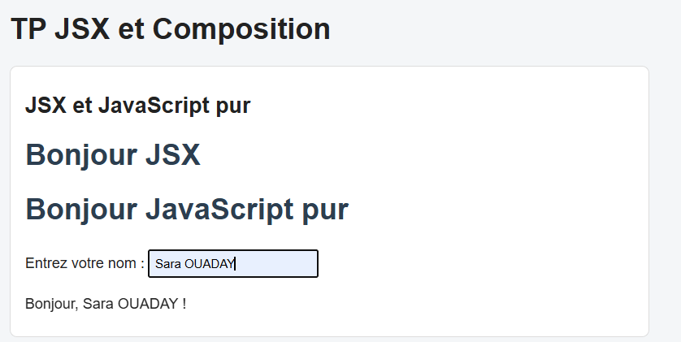
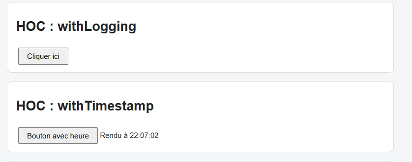
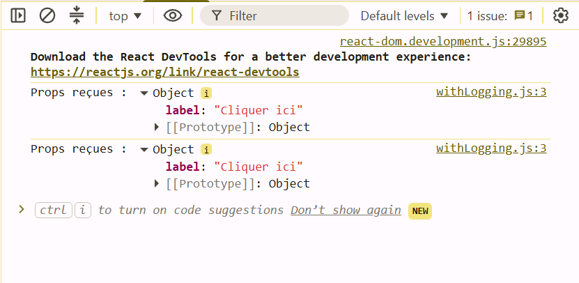
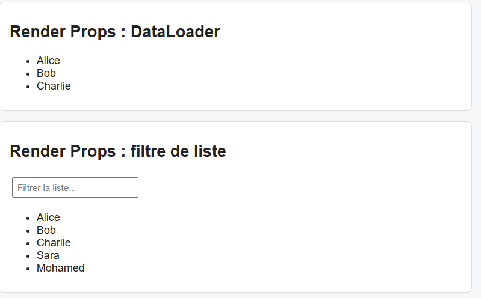
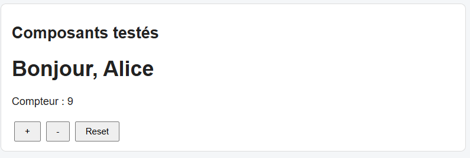
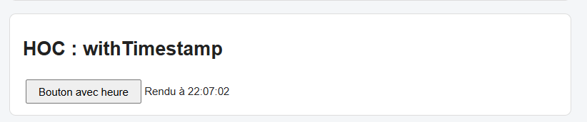
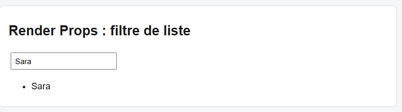
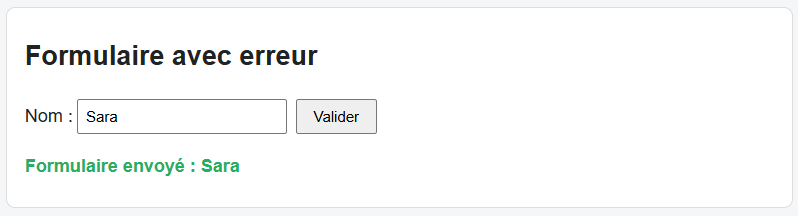

# TP 7 : JSX, composition avancée et tests React

> **Réalisé par :** OUADAY Sara

## Objectifs

- Comprendre ce qu'est JSX et comment il est transformé en JavaScript.
- Créer des composants réutilisables avec les Higher-Order Components (HOC) et les Render Props.
- Écrire des tests unitaires et d'intégration avec Jest et Testing Library.

## Structure

```
src/
├── App.js
├── App.css
├── JSXDemo.js
├── Button.js
├── ButtonWithLogging.js
├── withLogging.js
├── withTimestamp.js
├── withChargement.js
├── DataLoader.js
├── FiltreListe.js
├── FormulaireErreur.js
├── Greeting.js
├── Counter.js
├── ListeNoms.js
├── DemoChargement.js
├── Greeting.test.js
├── Counter.test.js
├── HOC.test.js
├── DataLoader.test.js
├── FiltreListe.test.js
├── FormulaireErreur.test.js
├── App.test.js
├── setupTests.js
├── index.js
└── index.css
```

## JSX

JSX est une écriture plus lisible de `React.createElement()`. Les deux titres affichés sont identiques. On utilise `className` au lieu de `class`, et `htmlFor` au lieu de `for`.



## HOC withLogging

Le HOC affiche les props dans la console avant de rendre le composant.





## Render Props avec DataLoader

Le composant `DataLoader` fournit des données et la fonction `render` décide de l'affichage.



## Tests

Les fichiers `Greeting.test.js` et `Counter.test.js` testent un affichage et un clic.



### HOC withTimestamp

Il ajoute l'heure du rendu sous le composant.



### Render Props pour filtrer une liste



### Test d'un formulaire avec erreur



## Conclusion

- JSX est du sucre syntaxique pour `React.createElement()`.
- Un HOC est une fonction qui reçoit un composant et en retourne un nouveau, avec une fonctionnalité en plus.
- Avec les Render Props, le composant fournit les données et le parent décide de l'affichage.
- Testing Library teste ce que voit l'utilisateur : le texte, les clics et les messages d'erreur.
